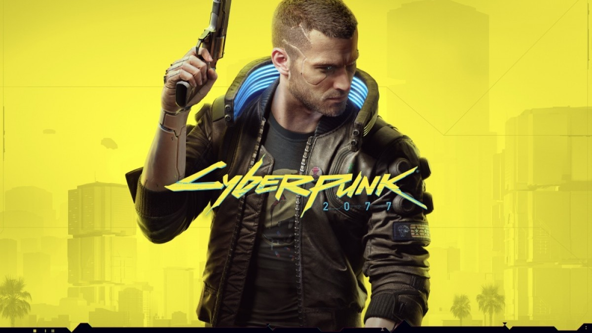

# Introdução ao jogo

Cyberpunk 2077 é um RPG de ação em mundo aberto que explora a luta pela sobrevivência e identidade em uma sociedade distópica dominada por corporações, onde suas escolhas moldam a história e o destino do protagonista.

## Objetivos

O jogador assume o papel de V, um mercenário personalizável que recebe um biochip cibernético contendo a consciência do lendário rockstar e terrorista Johnny Silverhand. A narrativa central gira em torno da tentativa de separar a consciência de Johnny da de V e sobreviver à perseguição da corporação Arasaka, que controla grande parte de Night City, uma metrópole futurista e distópica na Califórnia 
Arasaka, que controla grande parte de Night City, uma metrópole futurista e distópica na Califórnia . O jogo explora temas de imortalidade, identidade, poder corporativo e ética tecnológica.

## Jogabilidade e Personalização

Cyberpunk 2077 é jogado em primeira pessoa e combina combate, exploração e hacking. O jogador pode personalizar gênero, aparência, estilo de cabelo, tipo de corpo, roupas e cyberware, além de escolher um Rumo de Vida (Life Path) — Marginal, Corporativo ou Nômade — que influencia a narrativa e as interações com NPCs.O sistema de habilidades é dividido em categorias como Corpo, Inteligência, Reflexos, Habilidade Técnica e Moral, permitindo diferentes estilos de jogo, desde combate direto até hacking e furtividade.

# Personagens ou Itens

# História e Enredo

# Estratégia e Walkthrough

# Links úteis e fontes
https://www.cyberpunk.net/br/pt-br/
https://psverso.com.br/analises/
https://cyberpunk.fandom.com/wiki/Cyberpunk_2077
https://pt.wikipedia.org/wiki/Cyberpunk_2077

