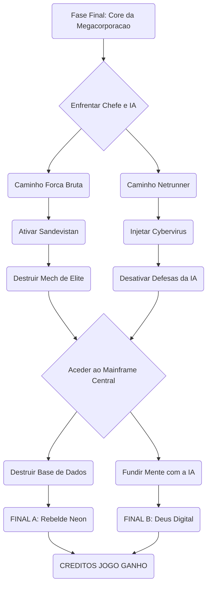

# Introdução ao jogo


# Personagens ou Itens


# História e Enredo


# Estratégia e Walkthrough

Fase Final: Operação Apocalypse Core

Para superares o clímax da missão no servidor central da megacorporação, deves seguir uma estratégia rigorosa que combina posicionamento e uso correto dos teus implantes cibernéticos. O confronto final inicia-se no momento em que cruzas os portões blindados do mainframe e enfrentas o Mech Guardião de Elite, cuja inteligência artificial controla os sistemas de defesa da sala.


Se o teu foco de jogo é o combate direto com a especialização Solo, a tua principal ferramenta de sobrevivência é o posicionamento geográfico na arena. O Mech inicia o combate ativando um escudo de plasma impenetrável que é alimentado por três geradores nos cantos da sala. Deves correr imediatamente para as coberturas de betão armado para evitar a linha de visão do inimigo. Arremessa granadas de pulso eletromagnético contra os geradores e dispara com munição térmica para os sobrecarregar. Assim que o escudo cair, o Mech disparará uma salva de mísseis teleguiados. O aviso sonoro dos mísseis é o teu sinal exato para ativar o implante Sandevistan. Com o tempo abrandado, desliza lateralmente para as costas do boss, onde uma escotilha de ventilação azul se abrirá por breves quatro segundos. Foca todo o teu arsenal pesado ou ataques de katana química nesse ponto fraco para vaporizar a barra de vida do inimigo.


Se a tua abordagem assenta na especialização Netrunner através da invasão do ciberespaço, a dinâmica da batalha exige furtividade total e gestão de memória RAM. Em vez de atacares o Mech diretamente, deves utilizar o teu scanner ocular para localizar o terminal secundário posicionado no flanco direito da arena. Move-te agachado por trás dos servidores e injeta o vírus malicioso no sistema. Enquanto a percentagem de carregamento avança, mantém-te oculto e fora do radar do inimigo. Utiliza a rotação de habilidades combinando a disfunção cibernética para paralisar os movimentos do Mech e o curto-circuito digitalizado para descarregar picos de voltagem diretamente nos circuitos dele. Caso o sistema de segurança da IA detete a tua assinatura digital e o nível de alerta ultrapasse o limite de segurança, executa imediatamente o apagão de memória para forçar o boss a perder o teu rasto e retomar o estado de busca.


A derrota do Mech Guardião liberta o acesso ao Mainframe Central, onde se processa a escolha final que dita o epílogo da história. Na opção de destruição física, ao instalares a carga explosiva no núcleo de arrefecimento, ficas com um limite estrito de sessenta segundos para abandonar o complexo. O caminho principal tranca-se automaticamente, pelo que deves ignorar os guardas secundários que entram na sala, subir a passadeira metálica à direita e utilizar os propulsores das pernas para alcançar a conduta de ventilação suspensa que serve de rota de fuga. Na opção de transcendência digital, ao conectares o teu biochip diretamente à cadeira neural, inicias uma fusão com a inteligência artificial. Para evitares que os sistemas de segurança fritem as tuas sinapses, deves resolver a matriz de código em menos de quatro movimentos lógicos, iniciando sempre a seleção de dados pela linha superior horizontal que partilha o mesmo sufixo do teu equipamento de computação.




```

```


# Links úteis e fontes