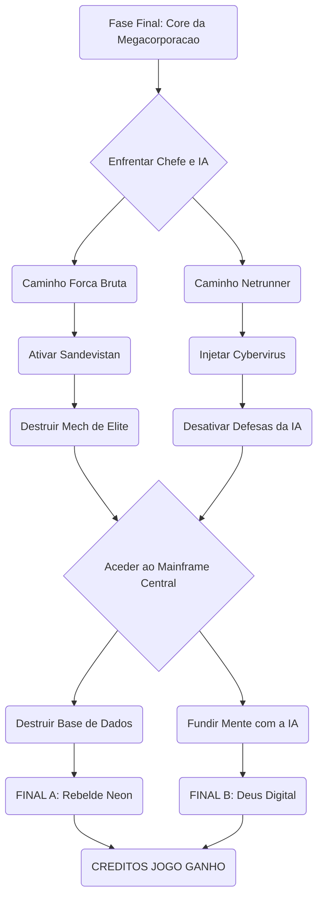

# Introdução ao jogo

Cyberpunk 2077 é um RPG de ação em mundo aberto que explora a luta pela sobrevivência e identidade em uma sociedade distópica dominada por corporações, onde suas escolhas moldam a história e o destino do protagonista.


## Objetivos

O jogador assume o papel de V, um mercenário personalizável que recebe um biochip cibernético contendo a consciência do lendário rockstar e terrorista Johnny Silverhand. A narrativa central gira em torno da tentativa de separar a consciência de Johnny da de V e sobreviver à perseguição da corporação Arasaka, que controla grande parte de Night City, uma metrópole futurista e distópica na Califórnia 
Arasaka, que controla grande parte de Night City, uma metrópole futurista e distópica na Califórnia . O jogo explora temas de imortalidade, identidade, poder corporativo e ética tecnológica.

## Jogabilidade e Personalização

Cyberpunk 2077 é jogado em primeira pessoa e combina combate, exploração e hacking. O jogador pode personalizar gênero, aparência, estilo de cabelo, tipo de corpo, roupas e cyberware, além de escolher um Rumo de Vida (Life Path) — Marginal, Corporativo ou Nômade — que influencia a narrativa e as interações com NPCs.O sistema de habilidades é dividido em categorias como Corpo, Inteligência, Reflexos, Habilidade Técnica e Moral, permitindo diferentes estilos de jogo, desde combate direto até hacking e furtividade.


<<<<<<< HEAD

# Personagens ou Itens
=======
## Personagens e Equipamento de Night City

Em Cyberpunk 2077, o ecossistema de Night City é moldado por mercenários lendários, corporações implacáveis e tecnologia cibernética de ponta. Abaixo estão detalhados os principais intervenientes e as armas/itens mais marcantes do jogo.

---

### Personagens Principais

#### 1. V (O/A Protagonista)
* **Descrição:** Mercenário(a) urbano(a) a tentar fazer o seu nome em Night City. A sua história e aparência variam de acordo com as escolhas do jogador.
* **Habilidades e Características:**
  * **Cyberware Adaptável:** Capacidade de instalar implantes em todas as partes do corpo.
  * **Hacker Nativo (Netrunning):** Acesso a *Quickhacks* para desativar inimigos, câmeras e sistemas de segurança à distância.
  * **Especialista em Combate:** Proficiência com armas de fogo, lâminas monomoleculares e combate corpo a corpo.

#### 2. Johnny Silverhand
* **Descrição:** Lendário *Rockerboy* e ex-vocalista da banda rebelde *Samurai*. A sua consciência reside num biochip impresso no cérebro de V.
* **Habilidades e Características:**
  * **Personalidade Carismática e Rebelde:** Influencia o enredo e as decisões de V ao longo do jogo.
  * **Atirador Experiente:** Mestre no uso do seu lendário canhão de mão (*Malorian Arms 3516*).
  * **Conhecimentos da Lenda de Night City:** Guia e conselheiro estratégico sobre o submundo das corporações.
>>>>>>> 0870ff20c93fb192347836313fbfc800570d0619


---

### Equipamento e Armamento Emblemático

#### Armas Notáveis

1. **Malorian Arms 3516 (Pistola Icónica do Johnny Silverhand)**
   * **Tipo:** Pistola de Potência (Power Pistol).
   * **Características:**
     * Dispara projéteis de alto calibre capazes de atravessar coberturas.
     * Ataque de corpo a corpo secundário que lança uma labareda de fogo para afastar inimigos.

2. **Lâminas Mantis (Mantis Blades)**
   * **Tipo:** Implante de Cyberware (Braços).
   * **Características:**
     * Lâminas retráteis integradas nos antebraços para combate de curto alcance.
     * Permite um ataque de investida (*Lunge*) que encurta instantaneamente a distância para o alvo.

---

## História e Enredo: A Luta pela Sobrevivência em Night City

A narrativa de *Cyberpunk 2077* desenrola-se no ano de 2077, na megalópole futurista de **Night City**, no estado da Califórnia. Num mundo dominado pela ganância das megacorporações, pela tecnologia obsessiva e pela modificação corporal, a história explora temas como a identidade, a mortalidade e o preço da ambição.

---

### O Enredo Principal

#### 1. A Origem de V e o Assalto ao Arasaka
Tudo começa quando **V**, um(a) mercenário(a) a tentar subir no submundo do crime, aceita o maior contrato da sua vida: roubar um protótipo de biochip ultra-secreto da gigantesca corporação **Arasaka**.
* **O Chip (*The Relic*):** Durante a fuga da missão que correu desastrosamente mal, o chip sofre danos e V vê-se obrigado(a) a inseri-lo no próprio cérebro para proteger o dispositivo.

#### 2. O Fantasma na Máquina
Ao acordar, V descobre a terrível verdade sobre o biochip:
* O chip contém a personalidade digitalizada de **Johnny Silverhand**, um lendário roqueiro e terrorista que morreu a tentar destruir a Arasaka em 2023.
* O sistema do chip começou a reescrever o cérebro de V, iniciando um processo irreversível em que a mente de Johnny substituirá a de V em questão de semanas.

#### 3. A Corrida Contra o Tempo
A partir deste ponto, o objetivo principal do jogo torna-se uma busca desesperada por uma cura:
* V precisa de explorar o submundo da cidade, aliar-se a *fixers*, *netrunners* e fações rivais para encontrar uma forma de remover o chip sem morrer no processo.
* Enquanto isso, a relação entre V e o fantasma de Johnny evolui, forçando o jogador a decidir entre cooperar com a lenda do passado ou resistir à sua influência.

---

### PONTOS-CHAVE DA NARRATIVA

* **A Arasaka Corporation:** A megacorporação japonesa responsável pela criação do *Relic* e pela maior parte do controlo e vigilância em Night City.
* **O Mnemónico da Morte:** O inevitável cronómetro biológico obriga o jogador a ponderar as suas alianças e prioridades ao longo da história.
* **Múltiplos Finais:** As escolhas feitas durante as missões principais e secundárias determinam o destino final de V, de Johnny e das pessoas mais próximas.


# Estratégia e Walkthrough

Fase Final: Operação Apocalypse Core

Para superares o clímax da missão no servidor central da megacorporação, deves seguir uma estratégia rigorosa que combina posicionamento e uso correto dos teus implantes cibernéticos. O confronto final inicia-se no momento em que cruzas os portões blindados do mainframe e enfrentas o Mech Guardião de Elite, cuja inteligência artificial controla os sistemas de defesa da sala.


Se o teu foco de jogo é o combate direto com a especialização Solo, a tua principal ferramenta de sobrevivência é o posicionamento geográfico na arena. O Mech inicia o combate ativando um escudo de plasma impenetrável que é alimentado por três geradores nos cantos da sala. Deves correr imediatamente para as coberturas de betão armado para evitar a linha de visão do inimigo. Arremessa granadas de pulso eletromagnético contra os geradores e dispara com munição térmica para os sobrecarregar. Assim que o escudo cair, o Mech disparará uma salva de mísseis teleguiados. O aviso sonoro dos mísseis é o teu sinal exato para ativar o implante Sandevistan. Com o tempo abrandado, desliza lateralmente para as costas do boss, onde uma escotilha de ventilação azul se abrirá por breves quatro segundos. Foca todo o teu arsenal pesado ou ataques de katana química nesse ponto fraco para vaporizar a barra de vida do inimigo.


Se a tua abordagem assenta na especialização Netrunner através da invasão do ciberespaço, a dinâmica da batalha exige furtividade total e gestão de memória RAM. Em vez de atacares o Mech diretamente, deves utilizar o teu scanner ocular para localizar o terminal secundário posicionado no flanco direito da arena. Move-te agachado por trás dos servidores e injeta o vírus malicioso no sistema. Enquanto a percentagem de carregamento avança, mantém-te oculto e fora do radar do inimigo. Utiliza a rotação de habilidades combinando a disfunção cibernética para paralisar os movimentos do Mech e o curto-circuito digitalizado para descarregar picos de voltagem diretamente nos circuitos dele. Caso o sistema de segurança da IA detete a tua assinatura digital e o nível de alerta ultrapasse o limite de segurança, executa imediatamente o apagão de memória para forçar o boss a perder o teu rasto e retomar o estado de busca.


A derrota do Mech Guardião liberta o acesso ao Mainframe Central, onde se processa a escolha final que dita o epílogo da história. Na opção de destruição física, ao instalares a carga explosiva no núcleo de arrefecimento, ficas com um limite estrito de sessenta segundos para abandonar o complexo. O caminho principal tranca-se automaticamente, pelo que deves ignorar os guardas secundários que entram na sala, subir a passadeira metálica à direita e utilizar os propulsores das pernas para alcançar a conduta de ventilação suspensa que serve de rota de fuga. Na opção de transcendência digital, ao conectares o teu biochip diretamente à cadeira neural, inicias uma fusão com a inteligência artificial. Para evitares que os sistemas de segurança fritem as tuas sinapses, deves resolver a matriz de código em menos de quatro movimentos lógicos, iniciando sempre a seleção de dados pela linha superior horizontal que partilha o mesmo sufixo do teu equipamento de computação.




```

```


<<<<<<< HEAD


# Links úteis e fontes
>>>>>>> cf4ba38a17b6d2d6195c8f726cb35e72636cb6a9
=======
# Links úteis e fontes
https://www.cyberpunk.net/br/pt-br/
https://psverso.com.br/analises/
https://cyberpunk.fandom.com/wiki/Cyberpunk_2077
https://pt.wikipedia.org/wiki/Cyberpunk_2077


>>>>>>> 3f3e54463384353c6f135edc6e3e2a99a0e7af64
